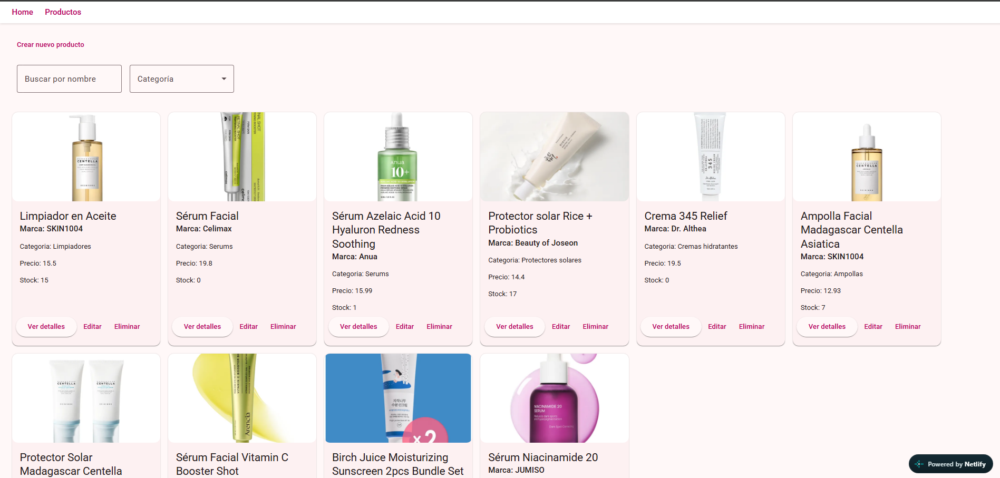
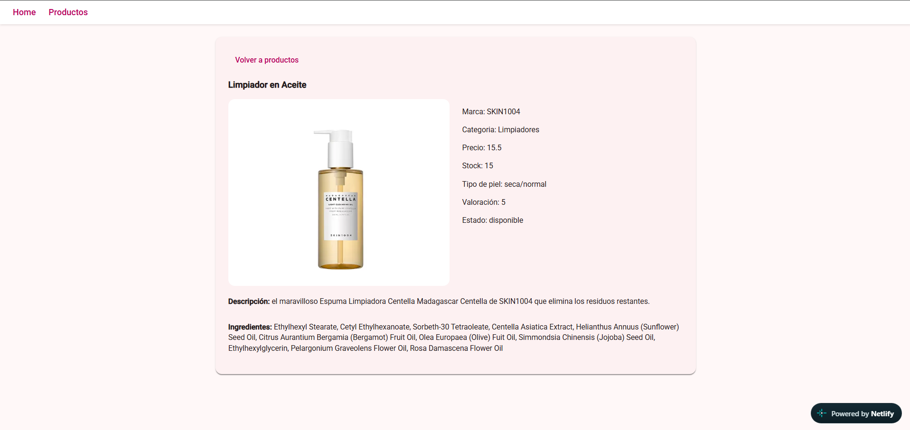
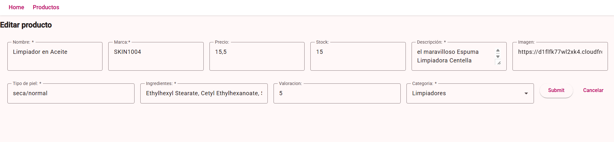
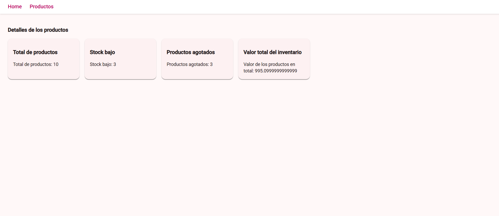

K-Beauty Stock Manager

Aplicación web de gestión de inventario para productos de skincare coreano (K-Beauty), desarrollada con Angular y TypeScript como proyecto de portfolio.

Permite gestionar un catálogo de productos con operaciones CRUD completas, búsqueda y filtrado en tiempo real, métricas de inventario calculadas dinámicamente, y una interfaz responsive construida con Angular Material.

Demo en vivo: https://gestiondeinventariok-bea.netlify.app/

Funcionalidades

- Dashboard con métricas de inventario en tiempo real: total de productos, productos con stock bajo, productos agotados y valor total del inventario.
- Listado de productos con búsqueda por nombre (ignorando acentos y mayúsculas/minúsculas) y filtrado por categoría.
- CRUD completo: creación, edición, eliminación y visualización detallada de productos.
- Formulario reactivo dual: un mismo formulario sirve para crear y editar productos, detectando automáticamente el modo según la ruta, con validaciones personalizadas y mensajes de error visibles.
- Routing dinámico: navegación entre vistas mediante rutas con parámetros (/product-detail/:id, /product-form/:id) y navegación programática tras guardar un producto.
- Gestión de estado con Angular Signals: un servicio central expone los datos como signals de solo lectura, con valores derivados (computed()) para las métricas del dashboard y los filtros de búsqueda.
- Interfaz responsive construida con Angular Material.

Decisiones de arquitectura

- Separación de responsabilidades: los componentes solo gestionan presentación; toda la lógica de datos vive en ProductoService.
- Encapsulación de estado: el signal de productos es privado dentro del servicio y se expone como solo lectura (asReadonly()) hacia los componentes.
- Inmutabilidad: las operaciones de creación, actualización y eliminación generan nuevas referencias de array (spread operator) en lugar de mutar el estado existente, siguiendo las buenas prácticas de Signals.

Cómo ejecutar el proyecto en local

Clonar el repositorio:
git clone https://github.com/Ludeynis/Gestion-de-inventario.git
cd kBeautyProject

Instalar dependencias:
npm install

Levantar el servidor de desarrollo:
ng serve

La aplicación estará disponible en http://localhost:4200/

Próximas mejoras

- Conexión a una API REST real mediante HttpClient
- Estados de carga y error explícitos
- Tests unitarios

Autora

Ludeynis Gamez
